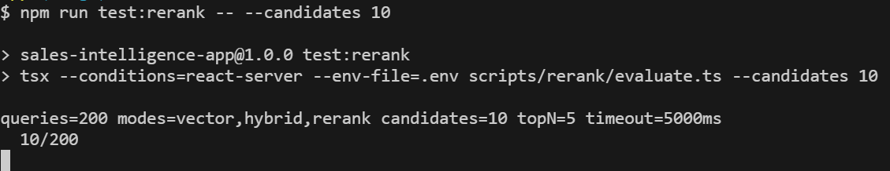

# 🤖 Workshop 2 — Sales Intelligence Agent

> Set up an agentic app on a RAG + Sales database, plus the job pipeline that powers data ingestion.

## 📋 Overview

| Field | Details |
|-------|---------|
| Topic | Agentic app with RAG + Cosmos DB |
| Goals | Run the app, add hybrid retrieval, harden the system prompt |
| Prerequisites | Node.js, npm, VS Code, Claude Code, your assigned number |
| Status | TBD |

## 🗺️ Steps

1. [Install](#-install)
2. [Configure environment](#-configure-environment)
3. [Run](#️-run)
4. [Hybrid retrieval](#-hybrid-retrieval)
5. [Clear context](#-clear-context)
6. [Prompt engineering](#-prompt-engineering)
7. [Clear context](#-clear-context)
8. [Cohere rerank](#-cohere-rerank)

---

## 📦 Install

In a new terminal, go to `workshop2/sales-intelligence-app` and run:

```bash
npm install
```

---

## 🔑 Configure Environment

1. Rename `.env.example` to `.env`.
2. Copy the values for these keys from the [shared doc](https://docs.google.com/document/d/1Z6GpFdtjK4mnuXADWi8en0MYPlHV5fG0mr_tdt8tNSc/edit?usp=sharing):

   | Key |
   |-----|
   | `API_KEY` |
   | `AzureWebJobsStorage` |
   | `SQL_DB_SALESINTELLIGENCE` |
   | `COSMOS_ENDPOINT` |
   | `COSMOS_KEY` |
   | `COSMOS_INFERENCE_ENDPOINT` |
   | `COSMOS_INFERENCE_KEY` |

3. Set `AUDIENCE_NAME` to your name + your assigned number, e.g. `yourname3`.

> ⚠️ Use the **same** value as in Workshop 1. Don't change it.

---

## ▶️ Run

In a new VS Code terminal:

```bash
npm run dev
```

Open <http://localhost:3000>.

---

## 🔍 Hybrid Retrieval

Make the app handle both **keyword** and **semantic** search.

### 1. Reproduce the gap

In the chat window at `localhost:3000`, ask:

```
Which customers are likely to leave us because they are unhappy with our product?
```

Expected (broken) answer: *"There are currently no customers classified as "At Risk" or "Critical,"…"*

### 2. Fix it with Claude Code

In the terminal where Claude Code is open, paste:

```
Implement hybrid retrieval in Cosmos DB by combining vector search (semantic similarity) with keyword search (exact terms), using BM25 + Vector.
```

### 3. Verify

Ask the **same question** from step 1 again. ✅ You should now get at-risk customers back.

---

## 🧹 Clear Context

In the Claude prompt:

```
/clear
```

---

## 🎯 Prompt Engineering

Stop the agent from passing off general knowledge as company policy.

### 1. Reproduce the gap

In the chat window, ask either:

- `What's standard industry refund policy?`
- `Per policy, what's P1 SLA?`

The agent answers from general knowledge, even though the data isn't in the RAG.

### 2. Fix it with Claude Code

Paste into Claude Code:

```
Retrieve before citing any policy or playbook. If nothing relevant is found, say "No playbook guidance found" instead of using general knowledge as if it were company policy. Add this to the system prompt under Tool Rules.
```

### 3. Verify

Re-ask the two questions. ✅ Expected: `No playbook guidance found`.

---

## 🧹 Clear Context

In the Claude prompt:

```
/clear
```

---

## 🏅 Cohere Rerank

Add a reranking stage after Cosmos DB retrieval and measure the gain.

### 1. Check environment

Confirm `COSMOS_INFERENCE_KEY` and `COSMOS_INFERENCE_ENDPOINT` in `.env` are updated with the correct values for your group.

### 2. Fix it with Claude Code

Paste into Claude Code:

```
## Implement Cohere Reranking

Integrate **Cohere Rerank** into the existing RAG pipeline. Cosmos DB retrieval is already implemented; add reranking as the next stage.

### Implementation
1. Retrieve top 20–50 candidate documents from Cosmos DB.
2. Pass the query and retrieved documents to Cohere Rerank.
3. Reorder results using relevance scores and return the top 5.
4. Preserve document IDs, metadata, citations and original scores.
5. Support enabling/disabling reranking for comparison.
6. Handle API failures and timeouts gracefully.

### Test Dataset & Execution
- Generate a dataset of **200 realistic test queries** based on the actual Knowledge Base (KB) documents and SQL data available in the project.
- Ensure queries and expected results are relevant to the actual data, not generic or fabricated.
- Use existing connection strings and configurations to access KB and SQL data.
- Include relevance labels and expected document IDs as ground truth.
- Provide an executable command such as `npm run test:rerank` to run all 200 queries and generate JSON/CSV evaluation reports.

### Environment Configuration
Use the existing `.env` configuration. Connect to Cosmos DB using:
- `COSMOS_INFERENCE_KEY`
- `COSMOS_INFERENCE_ENDPOINT`

### Evaluation Metrics

| Metric | Measurement |
|---|---|
| Precision@5 | Relevant documents in top 5 |
| MRR | Rank of first relevant result |
| NDCG@5 | Quality of relevance ordering |
| Latency | Additional reranking time |
| Cost | Additional Cohere API cost |

### Deliverables
- Cohere integration.
- 200-query evaluation dataset.
- Automated evaluation script.
- Before-and-after comparison: vector-only, hybrid and hybrid + reranking.
- Consolidated metrics report.

**Objective:** Quantify retrieval improvement against additional latency and API cost.
```

### 3. Run the evaluation

```bash
npm run test:rerank -- --candidates 10
```

### 4. Verify

Check the metrics. ✅ They should look like the output below.


