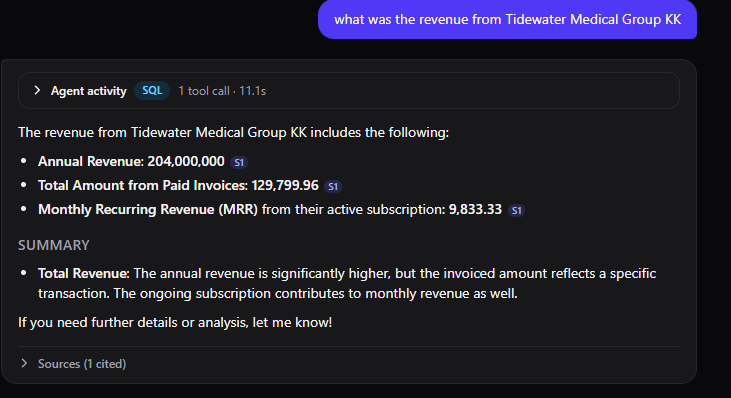
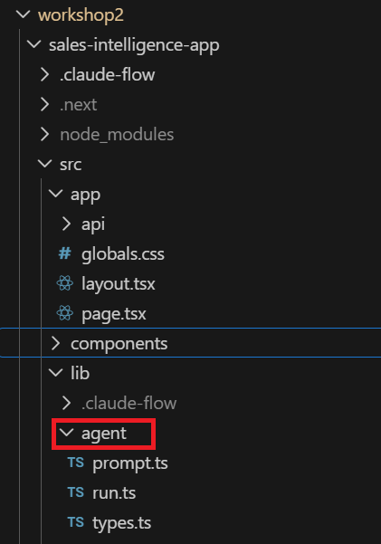
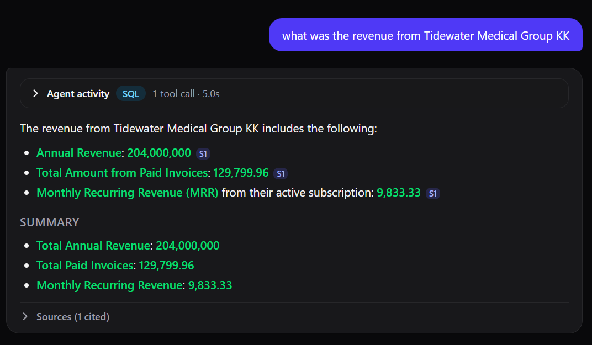

# Workshop 2 — Sales Intelligence Agent

> Set up an agentic app on a RAG + Sales database, plus the job pipeline that powers data ingestion.

## Overview

| Field | Details |
|-------|---------|
| Topic | Agentic app with RAG + Cosmos DB |
| Goals | Run the app, add hybrid retrieval, harden the system prompt |
| Prerequisites | Node.js, npm, VS Code, Claude Code, your assigned number |
| Status | TBD |

## Steps

1. [Install](#install)
2. [Configure environment](#configure-environment)
3. [Run](#run)
4. [Hybrid retrieval](#hybrid-retrieval)
5. [Prompt engineering](#prompt-engineering)
6. [Cohere rerank](#cohere-rerank)
7. [Few-shot prompting](#few-shot-prompting)

> Run `/clear` in Claude Code between exercises.

---

## Install

In a new terminal, go to `workshop2/sales-intelligence-app` and run:

```bash
npm install
```

---

## Configure Environment

1. Rename `.env.example` to `.env`.
2. Copy the values for these keys from the [shared doc](https://docs.google.com/document/d/1Z6GpFdtjK4mnuXADWi8en0MYPlHV5fG0mr_tdt8tNSc/edit?usp=sharing):

   | Key |
   |-----|
   | `API_KEY` |
   | `AzureWebJobsStorage` |
   | `SQL_DB_SALESINTELLIGENCE` |
   | `COSMOS_ENDPOINT` |
   | `COSMOS_KEY` |
   | `COSMOS_INFERENCE_ENDPOINT` |
   | `COSMOS_INFERENCE_KEY` |

3. Set `AUDIENCE_NAME` to your name + your assigned number, e.g. `yourname3`.

> Use the **same** value as in Workshop 1. Don't change it.

---

## Run

In a new VS Code terminal:

```bash
npm run dev
```

Open <http://localhost:3000>.

---

## Hybrid Retrieval

Make the app handle both **keyword** and **semantic** search.

> **Why this matters:** the knowledge base is searched by vector (semantic) similarity only. Embeddings capture *meaning*, not exact tokens, so look-alike codes such as `OPP-0663` and `OPP-0580` end up almost identical as vectors. A note that mentions `OPP-0663` exists, but vector search can't find it. Keyword search (BM25) matches the exact term.

### 1. Reproduce the gap

In the chat window at `localhost:3000`, ask:

```
What does the knowledge base say about OPP-0663?
```

Expected (broken) answer: *"The search did not return any specific information."*

The note does exist: *Deal Desk Notes - Dunmore Wireless Group*. Vector search returned five passages about **other** deals (Verdant Stores, Oakhaven Software, …). The system prompt's Tool Rules then correctly refuse to present those as an answer.

### 2. Fix it with Claude Code

In the terminal where Claude Code is open, paste:

```
Implement hybrid retrieval in Cosmos DB by combining vector search (semantic similarity) with keyword search (exact terms), using BM25 + Vector fused with weighted RRF (vector 3 : keyword 1). Add a full-text policy and full-text index on /text to my existing knowledge-base container. If the query contains an exact identifier such as OPP-0663, return the chunks that contain that exact identifier first.
```

> **Why the two extra rules?**
> - **Weighted RRF (3:1):** with equal weights, common question words like "buyer" and "says" outvote the semantic match, so meaning-based questions get *worse* (see check 2 below).
> - **Exact identifier first:** with a lone code as the query, RRF still ranks chunks that *don't* contain the code above the one that does, so the keyword gap would remain.

### 3. Verify both directions

Hybrid search has to keep **both** strengths: keyword matching for exact terms, and semantic matching for meaning.

**Check 1: keyword (the gap is fixed).** Ask the step 1 question again:

```
What does the knowledge base say about OPP-0663?
```

 Expected: the answer cites *Deal Desk Notes - Dunmore Wireless Group*. A **42%** discount was requested to match Vantara; it needs a CRO exception (above 30%), and the request is still pending with no CRO approval recorded.

**Check 2: semantic (nothing broke).** Ask:

```
What do we do when a buyer says we are too expensive?
```

 Expected: the answer cites *Pricing Objection Handling* and advises re-anchoring on total cost of ownership. No document contains the words "too expensive", so only semantic search finds this. It works before the fix and must still work after it.

| Question | Keyword only | Semantic only | Hybrid |
|---|---|---|---|
| `OPP-0663` | | | |
| *buyer says we are too expensive* | | | |

Want another keyword example? Try `What does the knowledge base say about OPP-0499?` (blocker: legal redlines on the DPA liability cap).

> Done? Run `/clear` in the Claude prompt.

---

## Prompt Engineering

Stop the agent from passing off general knowledge as company policy.

### 1. Reproduce the gap

In the chat window, ask either:

- `What's standard industry refund policy?` `Per policy, what's P1 SLA?`

The agent answers from general knowledge, even though the data isn't in the RAG.

### 2. To Fix it

Paste the below prompt under /lib/agent/prompt.ts above *## Style*

```
## Tool Rules
- Always call search_knowledge_base before stating any policy, playbook, SLA, refund, pricing or process rule. Never answer these from general knowledge.
- The knowledge base ALWAYS returns its closest passages, even when none are about the question. Count a passage as an answer ONLY if it explicitly covers the exact thing asked (e.g. it mentions refunds for a refund question, or a P1 / priority-1 support SLA for a P1 SLA question). Passages on neighbouring topics (billing, invoicing, payment terms, discounts, lead-response SLAs) are NOT an answer. Never present them as a substitute or as "related information".
- If no passage explicitly covers it, reply with exactly this sentence and nothing else:
  The search did not return any specific information
- In that case: no headings, bullets, related findings, citations, next steps or follow-up offers. This rule overrides the Citations and Style sections.
- If one message asks several questions, apply the rule to each one separately.
- Examples:
  User: "What's standard industry refund policy?" -> Assistant: "The search did not return any specific information"
  User: "Per policy, what's P1 SLA?" -> Assistant: "The search did not return any specific information"

```

### 3. Verify

Ask the below question.

```
What's standard industry refund policy? and Per policy, what's P1 SLA?
```

 Expected: `The search did not return any specific information`.

---

## Cohere Rerank

Add a reranking stage after Cosmos DB retrieval and measure the gain.

### 1. Check environment

Confirm `COSMOS_INFERENCE_KEY` and `COSMOS_INFERENCE_ENDPOINT` in `.env` are updated with the correct values for your group.

### 2. Fix it with Claude Code

Paste into Claude Code:

```
## Implement Cohere Reranking

Integrate **Cohere Rerank** into the existing RAG pipeline. Cosmos DB retrieval is already implemented; add reranking as the next stage.

### Implementation
1. Retrieve top 20–50 candidate documents from Cosmos DB.
2. Pass the query and retrieved documents to Cohere Rerank.
3. Reorder results using relevance scores and return the top 5.
4. Preserve document IDs, metadata, citations and original scores.
5. Support enabling/disabling reranking for comparison.
6. Handle API failures and timeouts gracefully.

### Test Dataset & Execution
- Generate a dataset of **200 realistic test queries** based on the actual Knowledge Base (KB) documents and SQL data available in the project.
- Ensure queries and expected results are relevant to the actual data, not generic or fabricated.
- Use existing connection strings and configurations to access KB and SQL data.
- Include relevance labels and expected document IDs as ground truth.
- Provide an executable command such as `npm run test:rerank` to run all 200 queries and generate JSON/CSV evaluation reports.

### Environment Configuration
Use the existing `.env` configuration. Connect to Cosmos DB using:
- `COSMOS_INFERENCE_KEY`
- `COSMOS_INFERENCE_ENDPOINT`

### Evaluation Metrics

| Metric | Measurement |
|---|---|
| Precision@5 | Relevant documents in top 5 |
| MRR | Rank of first relevant result |
| NDCG@5 | Quality of relevance ordering |
| Latency | Additional reranking time |
| Cost | Additional Cohere API cost |

### Deliverables
- Cohere integration.
- 200-query evaluation dataset.
- Automated evaluation script.
- Before-and-after comparison: vector-only, hybrid and hybrid + reranking.
- Consolidated metrics report.

**Objective:** Quantify retrieval improvement against additional latency and API cost.
```

### 3. Run the evaluation

```bash
npm run test:rerank -- --candidates 10
```

### 4. Verify

Check the metrics. They should look like the output below.


> Done? Run `/clear` in the Claude prompt.

---

## Few-Shot Prompting

Give the agent examples that show how it should behave. Goal: print numbers in **green**.

### 1. Reproduce the gap

In the chat window, ask:

```
what was the revenue from Tidewater Medical Group KK
```

Current output, numbers not highlighted:



### 2. Add examples

1. In VS Code, open `workshop2/sales-intelligence-app/src/lib/agent`.

   

2. Create a file named `few-shot-examples.md` with this content:

````markdown
Format key numbers in **bold** markdown. Never use HTML tags. Currency is not recorded, so no currency symbol.

## Example 1
Input: Total revenue is 150000.

Output:
Total revenue is **150,000**.

## Example 2
Input: Profit increased by 25%.

Output:
Profit increased by **25%**.

## Example 3
Input: Revenue is 250000 and expenses are 75000.

Output:
Revenue is **250,000** and expenses are **75,000**.

````

### 3. Fix it with Claude Code

Paste into Claude Code:

````
Inspect the existing prompt architecture, including `prompt.ts` and `run.ts`. The 'few-shot-examples.md' file already exists. Identify the final system prompt construction and load the existing Markdown file into it at runtime. Ensure examples are included before sending the prompt to the LLM. Reuse existing architecture and variable names. make sure you fix those bold that in markdown so it will show proper color and bold based on markdown

Add unit tests to verify:
- Few-shot file loads correctly.
- Examples are included in the final system prompt.
- Missing or empty files are handled gracefully.
- Existing prompt functionality remains unchanged.
- Final prompt is correctly passed to the LLM.

Do not duplicate examples or modify unrelated functionality. Run all relevant unit tests and report results.

````

### 4. Verify

Ask the **same question** again. Numbers now render in green:

```
what was the revenue from Tidewater Medical Group KK
```
Output should be below.



Go to [Workshop 3](../workshop3/readme.md).
