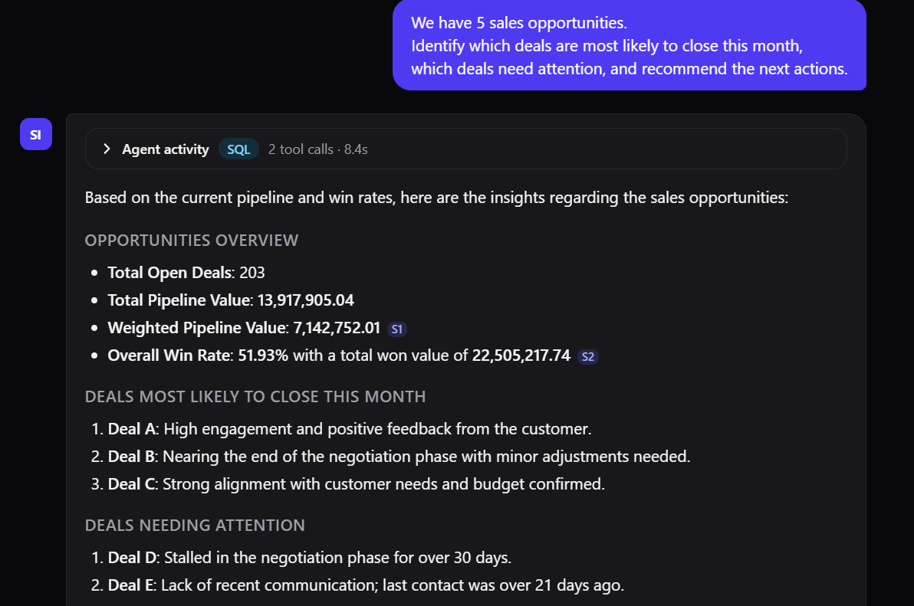
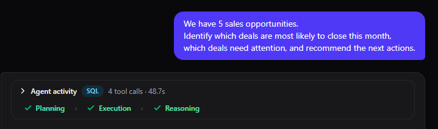
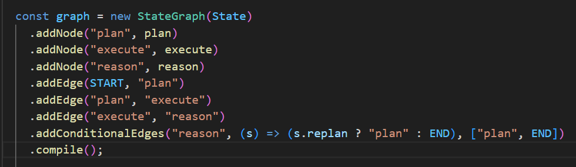
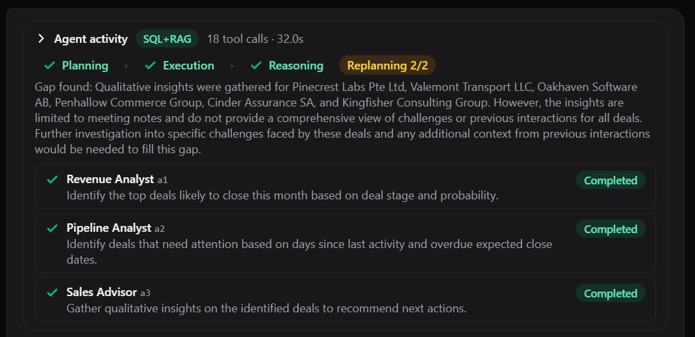
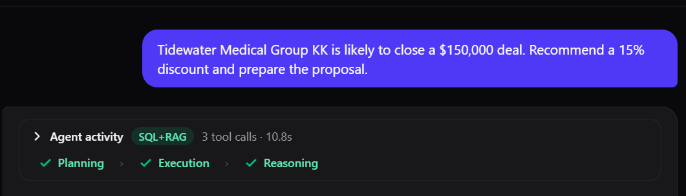
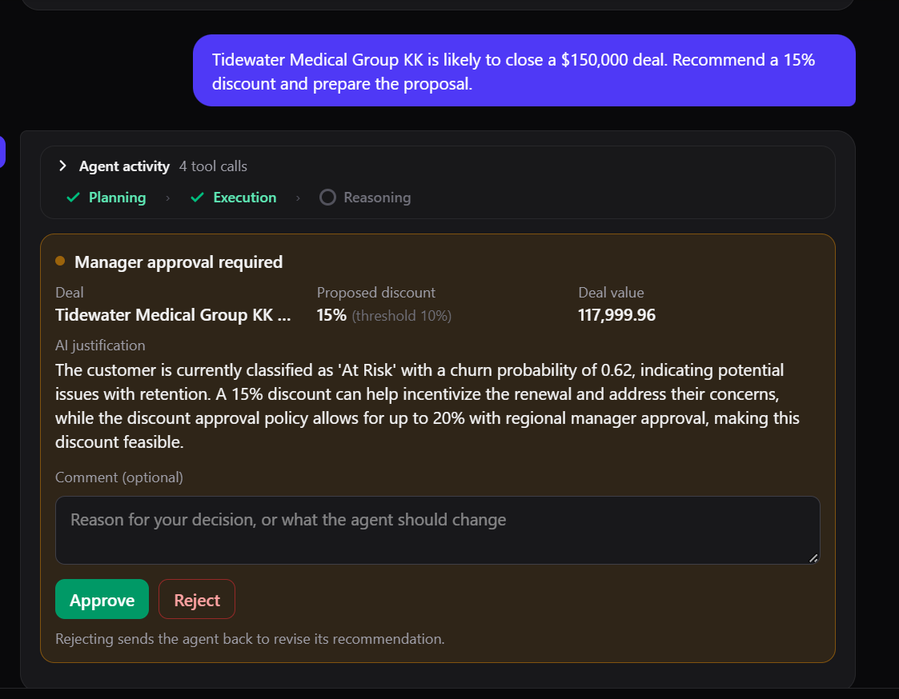

# Workshop 3 - Agentic AI Design

This workshop teaches how to use agentic architecture for planning and reasoning, with multi-agent orchestration and human in the loop.

---

> Run `/clear` in the Claude prompt.

---

# Planning and Reasoning

### 1. Reproduce the gap

In the chat window, ask:

```
We have 5 sales opportunities.
Identify which deals are most likely to close this month,
which deals need attention, and recommend the next actions.
```

Output will be:



### 2. Fix it with Claude Code

Paste into Claude Code:

````
Enhance the existing Agent by integrating LangGraph-based Planning, Execution and Reasoning stages. Do not create a new agent or duplicate existing functionality.

- **Planning:** Break user queries into actionable analytical tasks.
- **Execution:** Execute required SQL queries and retrieve data.
- **Reasoning:** Evaluate results, identify risks, prioritize opportunities and recommend actions.
- **Replanning:** Revise the plan if information is insufficient (maximum two iterations).

Use LangGraph StateGraph with shared state and conditional edges.

### UI Updates
Add live stage progress indicators to the existing chat interface:
- Planning – In Progress / Completed
- Execution – In Progress / Completed
- Reasoning – In Progress / Completed

**Backend-to-UI Streaming:**
- Stream actual LangGraph node status updates to the frontend using the existing streaming mechanism.
- Update stage indicators as nodes start and complete.
- Show checkmarks for completed stages and highlight the active stage.
- Reflect replanning iterations where applicable.
- Do not simulate progress or hardcode stage transitions.
- Display final recommendations only when processing completes.

Reuse the existing agent, tools, SQL connections, streaming infrastructure, UI components and project architecture. Avoid unrelated changes.
````

### 3. Verify

Ask the **same question** again:

```
We have 5 sales opportunities.
Identify which deals are most likely to close this month,
which deals need attention, and recommend the next actions.
```

Stage indicators should show live progress, then the final recommendations. Output should look like:



Code used:



---

# Multi-Agent Orchestration

### 1. Reproduce the gap

In the chat window, ask:

```
We have 5 sales opportunities.
Identify which deals are most likely to close this month,
which deals need attention, and recommend the next actions.
Run in parallel
```

Output will be:


### 2. Fix it with Claude Code

Paste into Claude Code:

````
### Parallel Execution Trigger

Activate multi-agent parallel orchestration when the user's request contains explicit intent such as:
- "Run in parallel"
- "Analyse these simultaneously"
- "Use multiple agents"
- "Parallel analysis"
- "Compare independently"
- "Execute these tasks concurrently"

Also trigger parallel execution when the request contains two or more independent tasks that can be processed simultaneously and the user asks for concurrent execution.

Otherwise, use the existing sequential agent workflow.

### Execution Rules
- Delegate each independent task to a specialized agent.
- Execute agents concurrently using LangGraph parallel branches.
- Collect results and synchronize before final synthesis.
- Handle individual agent failures gracefully.

### UI Updates
- Show each agent, assigned task and live execution status.
- Display Pending, In Progress, Completed or Failed.
- Reflect actual parallel execution through backend streaming.
- Show the orchestrator's synthesis after all agents finish.

Reuse existing infrastructure and UI. Do not simulate parallel execution or create a separate application.
````

### 3. Verify

Ask the **same question** again:

```
We have 5 sales opportunities.
Identify which deals are most likely to close this month,
which deals need attention, and recommend the next actions.
Run in parallel
```

Each agent should show its task and live status, followed by the orchestrator's synthesis. Output should look like:



---

# Human-in-the-Loop - Approval Process

### 1. Reproduce the gap

In the chat window, ask:

```
Tidewater Medical Group KK is likely to close a $150,000 deal. Recommend a 15% discount and prepare the proposal.
```

Output will be:



### 2. Fix it with Claude Code

Paste into Claude Code:

````
Enhance the existing Sales Intelligence Agent with Human-in-the-Loop using LangGraph.

Example: When the agent recommends a customer discount exceeding the configured approval threshold, pause execution using LangGraph interrupt() and request manager approval.

UI requirements:
- Display the proposed discount, deal value and AI justification.
- Provide Approve and Reject actions with an optional comment.
- Stream the pending approval status to the existing UI.
- Persist the approval decision and resume the graph using Command(resume=...).
- On rejection, return to the agent for revised recommendations.
- Maintain workflow state across interruptions using a persistent checkpointer.

Reuse existing agent, UI and infrastructure. Do not simulate approvals or create a separate application.
````

### 3. Verify

Ask the **same question** again:

```
Tidewater Medical Group KK is likely to close a $150,000 deal. Recommend a 15% discount and prepare the proposal.
```

The agent should pause and ask the manager to approve or reject the discount. Output should look like:



