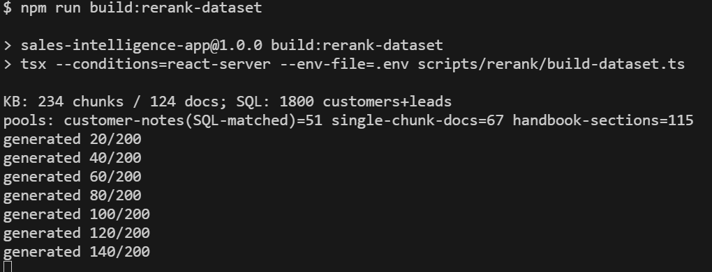
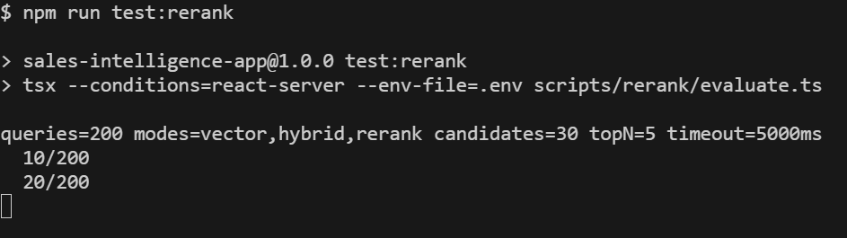
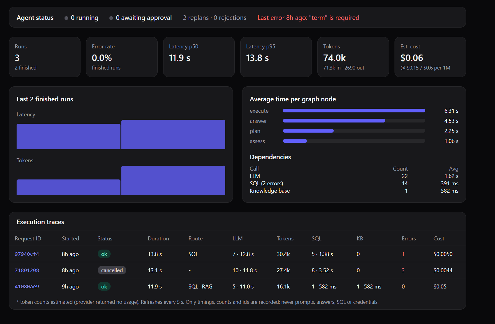

# Workshop 4 — Eval, Observability & Monitoring

Evaluate LLM + RAG quality, then add observability and monitoring so the agent is production-ready.

| Field | Details |
|-------|---------|
| Topic | LLM/RAG evaluation, observability, monitoring |
| Goals | TBD |
| Prerequisites | TBD |
| Status | TBD |

---

## Part 1 — Evaluation (LLM & RAG)

### 1. Generate the eval framework

Give the agent this prompt to build evals for the Sales Intelligence Agent:

```text
Implement an evaluation framework for the existing Sales Intelligence Agent covering LLM and RAG evaluation.

LLM Evaluation:
- Correctness, relevance, groundedness, consistency and format adherence.
- Use test questions with expected answers and scoring criteria.

RAG Evaluation:
- Context precision, context recall, MRR, faithfulness and answer relevance.
- Evaluate retrieved documents against ground-truth relevance labels.

Create a test dataset based on existing sales KB and SQL data. Run automated evaluations and generate a consolidated JSON/CSV report with individual scores and overall metrics.

Reuse existing architecture and connections. Avoid modifying agent functionality. Give me npm scripts to run the eval and tests, and it should have better details about the RAG and LLM.
```

### 2. Build the dataset

In the `sales-intelligence-app` folder:

```bash
npm run build:rerank-dataset
```

Output:



### 3. Run RAG retrieval evaluation

```bash
npm run test:rerank
```

Output:



### 4. View traces in the dashboard

```bash
npm run dev
```

Open the app to see LLM/RAG traces in the dashboard.

---

## Part 2 — Observability

### 1. Generate observability

Give the agent this prompt:

```text
Enhance the existing Sales Intelligence Agent with observability, distributed tracing and monitoring.

Implement end-to-end tracing across LangGraph nodes, LLM calls, SQL execution, RAG retrieval and agent orchestration.

Capture:
- Request ID and execution flow.
- Node start/end times and duration.
- LLM model, token usage and API latency.
- SQL execution time, rows returned and errors.
- Retrieval performance and document references.
- Agent failures, retries and total execution cost.

Add an observability dashboard to the existing UI showing execution traces, latency, token consumption, error rates and agent status.

Use structured logging and OpenTelemetry-compatible tracing. Ensure sensitive data and credentials are not logged.

Reuse existing architecture and infrastructure. Avoid unrelated changes.
```

### 2. View the dashboard

Navigate to **Observability** in the web app.

Output:


